# task

Adds `/task` to work toward a goal until an independent evaluator verifies completion.

## Usage

```text
/task --goal "<prompt>"
/task --goal "<prompt>" --implementer-model provider/id --checker-model provider/id
/task --goal "<prompt>" -d
/task --status
/task --evaluator
/task --list
/task --resume
/task --resume <id>
/task --stop
```

`--goal` (or `-g`) supplies a new goal. Quote values containing spaces. Positional prompts and task-type selectors are no longer accepted.

In interactive Pi, each omitted model opens a selection dialog. `--implementer-model` selects the main agent's model for this task; `--checker-model` selects the independent checker's model. Use `provider/id` from Pi's available models. `-d` (or `--defaults`) skips dialogs: an omitted implementer uses the current session model, and an omitted checker uses the selected implementer model. Explicit model flags skip their corresponding dialogs. In noninteractive modes, provide both model flags or use `-d`. The extension restores the previous session model when the task ends within the session.

Large model catalogs are shown four models per page. Choose `Next page →` or `← Previous page` to browse, or `Search models…` to filter by provider or model ID. The same bounded picker works in Pi's terminal and RPC dialogs.

```text
/task --goal "implement the cart feature and verify it end to end"
```

Use the equals form for a goal beginning with a hyphen, for example `/task --goal="--repair the parser"`.

Send an ordinary message to add information or change the active goal. Pi delivers it to the implementer. During planning, the extension queues the message and refreshes the checklist before work starts. During verification, the message cancels the current check; the implementer handles the update, then the checker verifies again. During backoff, the message resumes work immediately. Use `/task --status` to see the current phase and `/task --stop` to pause the task. Stopping or shutting down the session cancels pending retries and aborts an active checker.

The active role animates into a compact panel above the editor. The evaluator appears as a collapsed footer status while the implementer works; use `/task --evaluator` or **Ctrl+Alt+E** to expand or collapse its detail. During an evidence request, the implementer and evaluator appear in separate columns. Narrow terminals stack the two panels. The evaluator panel closes during goal backoff and opens again when checking resumes.

When the implementer needs information or a physical action, it can call `task_ask_user`. Pi pauses that implementing run and shows a confirmation or text input dialog. For example, the implementer can ask you to turn on a device and confirm when it is ready. A declined or dismissed dialog is reported to the implementer; it does not count as confirmation. The dialog requires a Pi UI. In a mode without one, the tool reports that the request cannot be shown.

## Resume an unfinished goal

`/task --list` shows saved goals for the current workspace with short IDs. `/task --resume` opens a searchable, paged picker; `/task --resume <id>` resumes the matching ID directly. In a mode without an interactive UI, pass an ID you previously copied from the list or from a saved record. A goal still running in another live Pi process cannot be resumed. If a saved model is no longer available, interactive Pi asks for replacement models.

Task records live under Pi's agent directory in `task-goals/` as private JSON files. They retain the goal, text updates, user dialog answers, and model choices. `/task --stop`, session shutdown, and interrupted runs leave the record available; independent completion removes it. Records remain even when Pi was started with `--no-session`.

Resume creates a new checker checklist and verifies the **current workspace before the implementer works again**. If the goal is already complete, the task ends without an extra implementing turn. If it is incomplete, the checker supplies fresh gaps and the normal backoff loop continues. In-flight agent and checker runs are not restored. Starting a new Pi session also starts a new conversation; the resumed implementer receives the saved goal and updates plus fresh checker feedback. Image attachments are not stored in the task record, so resend any image needed after a restart.

## How it works

The task uses two agent roles: Worker 1 is the main Pi agent that implements the goal; Worker 2 is an independent checker launched in a separate Pi process for planning or evaluation. The task extension controls model selection, waits, and retries shown in gray.

```mermaid
stateDiagram-v2
    accTitle: Goal task workers and state transitions
    accDescr: One implementer and one checker role alternate. The checker can pause its current run for up to five evidence dialogs with the implementer, which may ask the user to act. Stopping saves an unfinished goal; resuming rebuilds the checklist and verifies the live workspace.

    state "Worker 2: checker plans checklist" as Planning
    state "Worker 1: implementer works" as Working
    state "Worker 2: checker verifies workspace" as Checking
    state "Worker 2: checker waits in evidence tool" as EvidenceWait
    state "Worker 1: implementer answers" as EvidenceAnswer
    state "User: answer or perform action" as UserDialog
    state "Extension: select models" as Models
    state "Extension: planning retry" as PlanningRetry
    state "Extension: goal backoff" as GoalBackoff
    state "Extension: checker retry" as CheckingRetry
    state "Extension: saved, paused goal" as Paused

    classDef implementer fill:#ddf5e3,stroke:#2d6a4f,color:#123524
    classDef checker fill:#e2f0ff,stroke:#2563a6,color:#102a43
    classDef extension fill:#f1f3f5,stroke:#687076,color:#202428
    classDef user fill:#fff3cd,stroke:#9a6700,color:#423000
    class Working,EvidenceAnswer implementer
    class Planning,Checking,EvidenceWait checker
    class Models,PlanningRetry,GoalBackoff,CheckingRetry,Complete,Stopped,Paused extension
    class UserDialog user

    [*] --> Models: /task --goal
    Models --> Planning: selections made or defaults requested
    Models --> Stopped: selection cancelled, model unavailable, or session shutdown
    Paused --> Planning: /task --resume, rebuild checklist

    Planning --> Working: checklist ready, send goal to implementing agent
    Planning --> Checking: resumed goal, verify workspace first
    Planning --> Planning: new user information refreshes checklist
    Planning --> PlanningRetry: checker creation or planning fails
    PlanningRetry --> Planning: retry delay expires

    Working --> Checking: implementing agent settles
    Working --> Working: new user message steers current run
    Working --> UserDialog: task_ask_user pauses this run
    UserDialog --> Working: answer resumes same run
    Checking --> EvidenceWait: request specific evidence (at most five)
    EvidenceWait --> EvidenceAnswer: extension forwards question
    EvidenceAnswer --> UserDialog: task_ask_user if user action needed
    UserDialog --> EvidenceAnswer: answer resumes evidence reply
    EvidenceAnswer --> Checking: reply returns to the same checker run
    Checking --> Working: new user message cancels current check
    Checking --> Complete: independent evaluator verifies every criterion
    Checking --> GoalBackoff: goal incomplete with evidence-based gaps
    GoalBackoff --> Working: delay expires, send goal and gaps
    GoalBackoff --> Working: new user message cancels backoff
    Checking --> CheckingRetry: checker fails or times out
    CheckingRetry --> Checking: delay expires, evaluate same workspace
    CheckingRetry --> Working: new user message cancels retry

    Planning --> Paused: invalid checker launch configuration
    Planning --> Paused: implementer model switch fails
    Working --> Paused: implementing run aborted
    Planning --> Paused: /task --stop or session shutdown
    PlanningRetry --> Paused: /task --stop or session shutdown
    Working --> Paused: /task --stop or session shutdown
    Checking --> Paused: /task --stop or session shutdown
    EvidenceWait --> Paused: /task --stop or session shutdown
    EvidenceAnswer --> Paused: /task --stop or session shutdown
    UserDialog --> Paused: /task --stop or session shutdown
    CheckingRetry --> Paused: /task --stop or session shutdown
    GoalBackoff --> Paused: /task --stop or session shutdown

    Complete --> [*]
    Paused --> [*]
    Stopped --> [*]
```



The checker stays in its current run while its evidence tool waits for the implementer. The implementer can ask the user through `task_ask_user` before replying. The checker then continues and verifies evidence directly. A checker retry does not start another implementing run; an incomplete goal or new user information sends the implementer back to work. Both retry paths back off from 1 second to a maximum of 60 seconds.

## Retry backoff

When the evaluator reports an unmet goal, the extension waits before sending the original prompt and the evaluator's evidence-based gaps to the implementing agent. Successive delays are **1, 2, 4, 8, 16, 32, then 60 seconds**, capped at 60 seconds for every subsequent retry. Each new task starts at 1 second.

There is no run limit: the loop continues until the goal is independently verified or the user stops it. Checker creation, planning, and evaluation failures (including timeout or an invalid decision) retry with a separate exponential backoff of **1, 2, 4, …, 60 seconds**. Planning retries occur before implementation starts; evaluation retries check the same workspace without starting another implementing run. Successful planning or evaluation resets the checker retry delay. User cancellation or an aborted implementing-agent run stops the task immediately. Invalid launch configuration, unavailable models, and failed implementer model switches stop the task with an error.

## Independent verification

Each task uses an independent evaluator running in a separate Pi process with the **selected checker model** and the main session's thinking level.

Before implementation starts, the evaluator:

1. Inspects the starting workspace.
2. Creates a private temporary Markdown checklist with concrete acceptance criteria.
3. Adds a direct verification method to every checklist item.

Planner text and tool activity stream into the evaluator panel while planning is active. When planning finishes, the panel retains the generated checklist behind its expandable status. Later evaluation runs reopen the panel and refresh it with the updated checklist.

Whenever the main agent settles, a fresh evaluator run reads that checklist and inspects the live workspace. It is explicitly instructed to:

- verify with files, diffs, tests, typechecks, and focused commands;
- distrust claims, summaries, and pre-checked boxes without reproducing evidence;
- update the checklist with evidence and remaining gaps;
- never implement fixes or modify project files;
- report complete only when every criterion is independently verified.

The checker runs in [Pi JSON mode](https://github.com/earendil-works/pi/blob/main/packages/coding-agent/docs/json.md). The extension reads completed `message_end` events and waits for `agent_settled`, so tool turns and automatic recovery do not become the final decision. The final assistant message must end normally and contain one JSON decision object, optionally wrapped in a whole-response JSON fence. Malformed JSONL, ambiguous text, truncated output, and missing settlement fail that checker run and use the checker retry path.

The implementing agent does not receive or author the checklist. If the goal is incomplete, it receives the original prompt plus the evaluator's concise, evidence-based gaps. The evaluator's scratchpad is removed when the task ends.

During evaluation, the checker may call `request_goal_evidence` after trying direct verification. It must name the criterion, ask one specific question, and say what it already inspected. The extension forwards the question to the implementer and passes the implementer's reply into the **same blocked checker run**. If the answer needs a user action, the implementer can show the user dialog before replying. User updates received during this exchange also reach the checker. The checker treats the implementer's reply only as a pointer and independently inspects files or reruns commands before accepting it. At most five dialogs are forwarded per task; later requests receive a limit message and unresolved criteria remain incomplete. The checker run's active-work timeout pauses while it waits for an evidence reply.

Goal evaluators inherit the host's resource and security restrictions and project-trust decision. They use the selected checker model and the main session's thinking level. Each evaluator run has a 10-minute timeout.

## Status

The footer's `task` slot shows the current phase, for example:

- `↻ task goal planning`
- `↻ task goal 1`
- `↻ task goal checking (2)`
- `↻ task goal evidence request 2/5`
- `↻ task goal retrying in 2s (2)`
- `↻ task goal checker retrying in 1s (1)`

The evaluator has its own footer slot: `Evaluator ▸` means its detail is collapsed, `Evaluator ▾` means it is expanded, and `Evaluator ↔ Implementer` means they are exchanging evidence.

Only one task can be active in a session at a time.

## Module design

Tests live in `__tests__` directories beside their source modules.

Each domain module exports a `T` data type and free functions over it, imported as a module namespace:

```ts
import * as Task from "./task.js";

const planning = Task.create({ prompt: "fix checkout" });
const working = Task.work(planning);
const checking = Task.check(working);
```

`Task` models phases as a readonly discriminated union. Transitions return new values; backoff, status text, and continuation prompts are pure functions. `TaskArgs.parse` and `GoalDecision.parse` return `@praha/byethrow` results for invalid input.

`TaskModels.choose` resolves explicit model flags, interactive selections, or defaults before the checker starts. The selected implementer model is applied when work begins, then the previous session model is restored when the task stops.

`GoalChecker.T` stores configuration and scratchpad paths. `GoalChecker.create`, `initialize`, `evaluate`, and `dispose` perform the subprocess and filesystem work and return async results. Hosts and tests can inject a `GoalChecker.Operations` module through the extension's `goalChecker` option.

`GoalStreamDisplay.applyUpdate` computes immutable display content. `TaskSession` owns cancellation, timers, and resource cleanup. The entry point wires these modules to Pi events, keeping mutable resource handles at the effect boundary.
